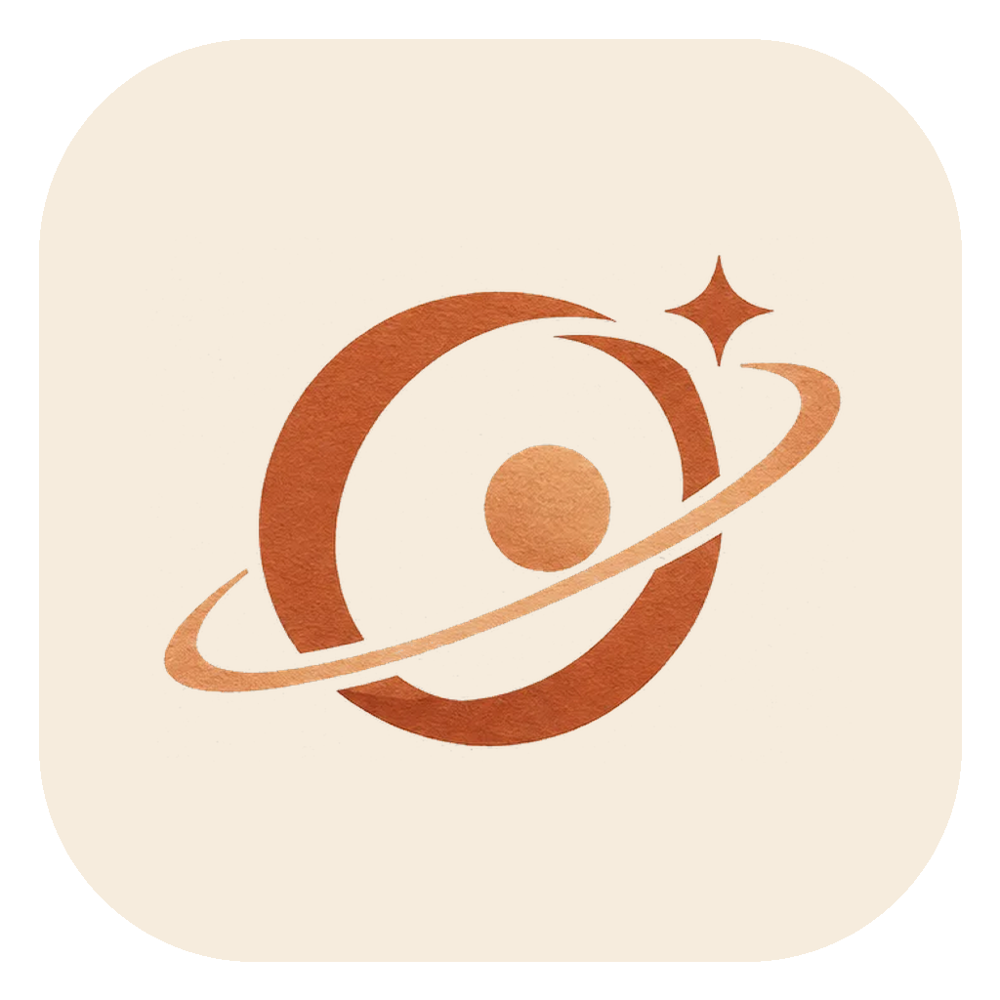
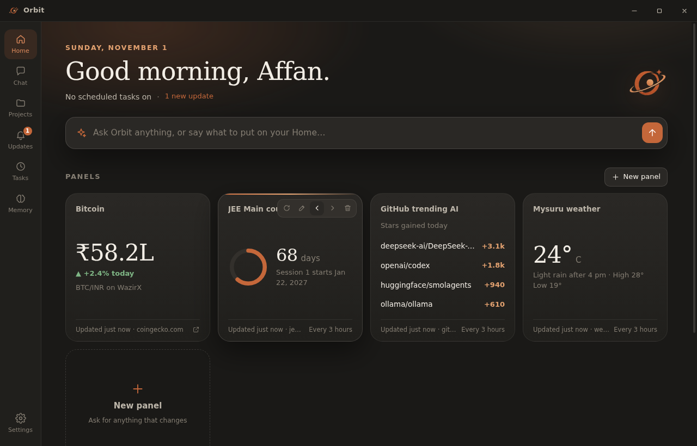
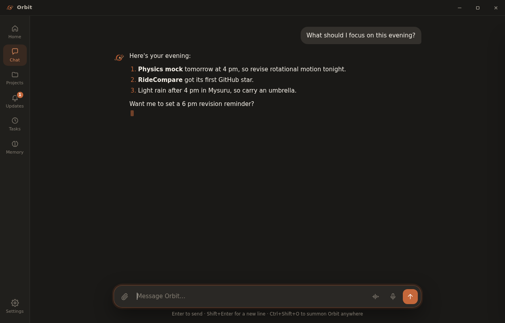
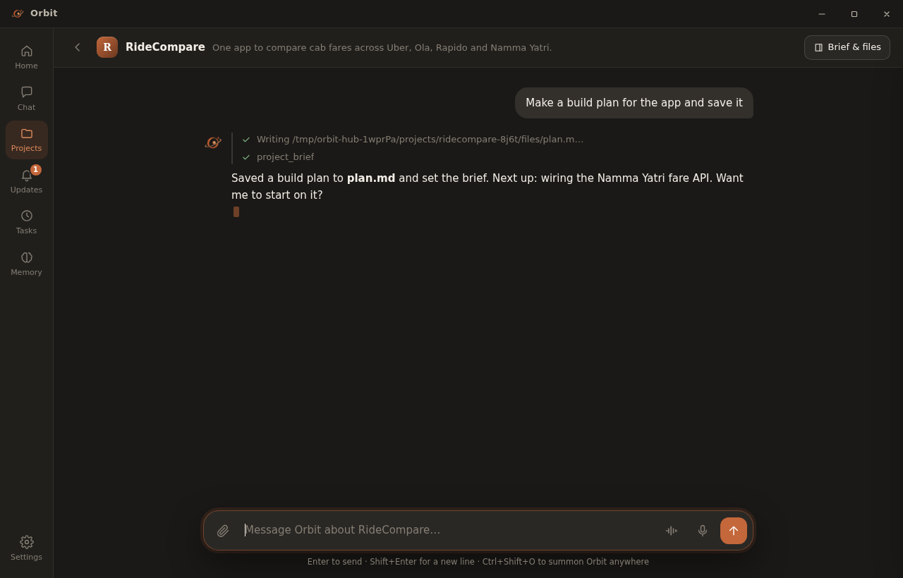
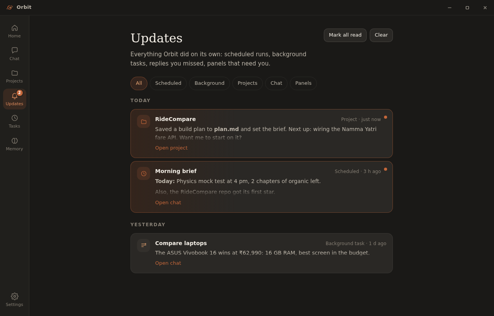
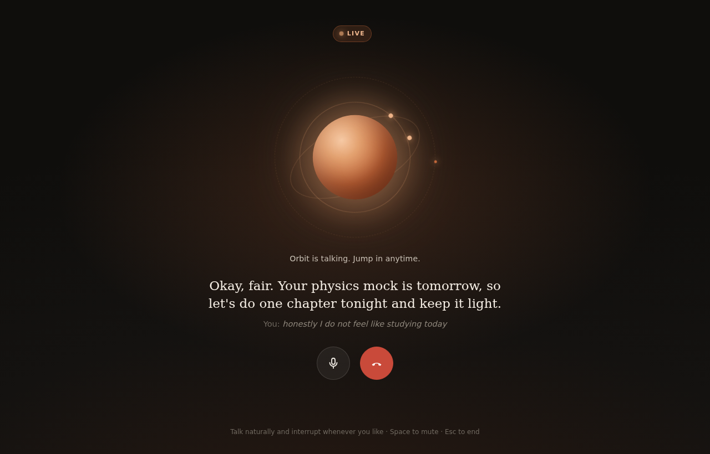

<p align="center"></p>
<h1 align="center">Orbit <sup>beta</sup></h1>
<p align="center"><b>Your AI agent for Windows.</b> Bring any model. Orbit runs your computer for you.</p>
<p align="center">
  <a href="https://github.com/AstralVortex1610/OpenOrbit/releases/latest"></a>
  
  
  <a href="https://github.com/AstralVortex1610/OpenOrbit/stargazers"></a>
</p>



> **Beta.** Orbit is new and moving fast. Expect rough edges, and please [open an issue](https://github.com/AstralVortex1610/OpenOrbit/issues) when something breaks.

## Download
1. Get `Orbit-<version>-win.zip` from [Releases](https://github.com/AstralVortex1610/OpenOrbit/releases/latest).
2. Unzip it and run `Orbit.exe`. It isn't code-signed yet, so if SmartScreen shows a warning, click **More info → Run anyway**.
3. Open **Settings → Brain**, enter a base URL, an API key and a model, then click **Test connection**.

## What it does
- **Any model.** Presets for US, Chinese, EU and local labs. Any OpenAI-compatible endpoint works, including Ollama and LM Studio.
- **Uses your computer.** Runs commands, reads and writes files, drives your installed Edge or Chrome, and clicks through Windows apps with UI Automation. It asks before anything consequential.
- **Works in parallel.** Background workers run several tasks at once, and Orbit still answers you while it's busy.
- **Projects.** Each project gets its own chat, brief and files.
- **Home and Updates.** Live panels that refresh themselves, plus a feed of everything Orbit has finished.
- **Email and calendar.** Gmail and Google Calendar, using your own Google sign-in.
- **Scheduled tasks and memory.** Recurring jobs, and a memory of what matters to you.
- **Phone pings.** ntfy or Telegram, so you can answer Orbit when you're away from your desk.
- **Voice.** An offline "Hey Orbit" wake word, plus a live call mode where Orbit talks first. It runs on-device with Phonon, or uses Gemini Live or OpenAI if you add a key.

| | |
|---|---|
|  |  |
|  |  |

## Build from source
```bash
npm install
npm start                               # run it
npx electron-builder --win zip --x64    # Windows build in dist/
```
Your data lives in `%APPDATA%\Orbit`, and API keys are encrypted with Windows' own key store. Developer notes are in [DEVNOTES.md](DEVNOTES.md).

## License
MIT © 2026 Affan Mohammed
